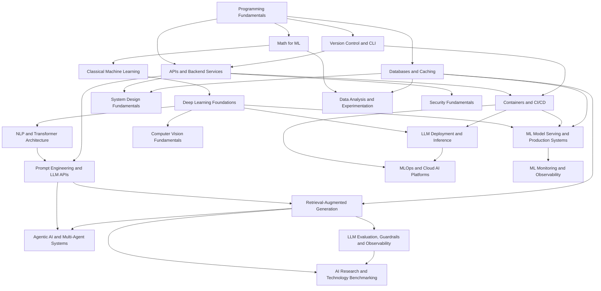

# Modules

The reusable module library. Each file is one learning step: a goal, a core-topics checklist, resources, a milestone deliverable, and its prerequisite modules. A roadmap for a specific job is a subset of these, topologically ordered, chained into one capstone project — see [../README.md](../README.md) for how to assemble one.

## Index by category

**Foundations**
- [Programming Fundamentals](foundations/programming-fundamentals.md)
- [Version Control & CLI](foundations/version-control-and-cli.md)

**Backend**
- [APIs & Backend Services](backend/apis-and-services.md)
- [Databases & Caching](backend/databases-and-caching.md)
- [Containers & CI/CD](backend/containers-and-ci-cd.md)
- [System Design Fundamentals](backend/system-design-fundamentals.md)

**Data & ML**
- [Math for ML](data-and-ml/math-for-ml.md)
- [Classical Machine Learning](data-and-ml/classical-machine-learning.md)
- [Deep Learning Foundations](data-and-ml/deep-learning-foundations.md)
- [Data Analysis & Experimentation](data-and-ml/data-analysis-and-experimentation.md)
- [ML Model Serving & Production Systems](data-and-ml/ml-model-serving-and-production-systems.md)

**Computer Vision**
- [Computer Vision Fundamentals](computer-vision/computer-vision-fundamentals.md)

**AI / [LLM](../../engineering/concepts/ai/generation/llm.md)**
- [NLP & Transformer Architecture](ai-llm/nlp-and-transformers.md)
- [Prompt Engineering & LLM APIs](ai-llm/prompt-engineering-and-llm-apis.md)
- [Retrieval-Augmented Generation](ai-llm/retrieval-augmented-generation.md)
- [Agentic AI & Multi-Agent Systems](ai-llm/agentic-ai-and-multi-agent-systems.md)
- [LLM Evaluation, Guardrails & Observability](ai-llm/llm-evaluation-and-guardrails.md)
- [LLM Deployment & Inference](ai-llm/llm-deployment-and-inference.md)

**Platform**
- [MLOps & Cloud AI Platforms](platform/mlops-and-cloud-ai-platforms.md)
- [ML Monitoring & Observability](platform/ml-monitoring-and-observability.md)
- [Security Fundamentals](platform/security-fundamentals.md)

**Career** (cross-cutting — pair with any technical path)
- [Domain Specialization](career/domain-specialization.md) (placeholder — fill in per job)
- [AI Research & Technology Benchmarking](career/ai-research-and-benchmarking.md) (the AI builder → AI research/innovation engineer skill jump)
- [Portfolio & Certifications](career/portfolio-and-certifications.md)
- [Soft Skills & Interview Prep](career/soft-skills-and-interview-prep.md)

## Dependency graph

A module's own header lists only its *direct* prerequisites — this graph shows the whole picture at once.

`Domain Specialization`, `Portfolio & Certifications`, and `Soft Skills & Interview Prep` are cross-cutting — they pair with whichever technical modules a given roadmap includes, rather than sitting at a fixed point in the graph. `AI Research & Technology Benchmarking` is the one Career module with real prerequisites — it's a senior/architect-level step up from an already-working RAG/eval stack, not a day-one module.

## Not every job needs every module

A backend-only role might stop after Backend. A classical-data-science role might skip straight from Data & ML to Platform, never touching AI/[LLM](../../engineering/concepts/ai/generation/llm.md) at all. Only include what the job's skill-category list in the [job profile](../templates/job-profile-template.md) actually maps to.

## Worked examples using this library

See [../jobs/](../jobs/) for complete roadmaps assembled from these modules: [Senior AI Engineer / Agentic AI Architect](../jobs/ai-engineer/roadmap.md) (LLM/agentic-heavy), [Machine Learning Engineer](../jobs/ml-engineer/roadmap.md) (production ML systems), [Data Scientist](../jobs/data-scientist/roadmap.md) (analysis/experimentation-heavy, deployment-light), [Computer Vision Engineer](../jobs/computer-vision-engineer/roadmap.md) (CV-heavy, hardware-constrained), and [MLOps / ML Platform Engineer](../jobs/mlops-engineer/roadmap.md) (platform/infrastructure-first). Each shows the same module library producing a noticeably different shape of roadmap.
